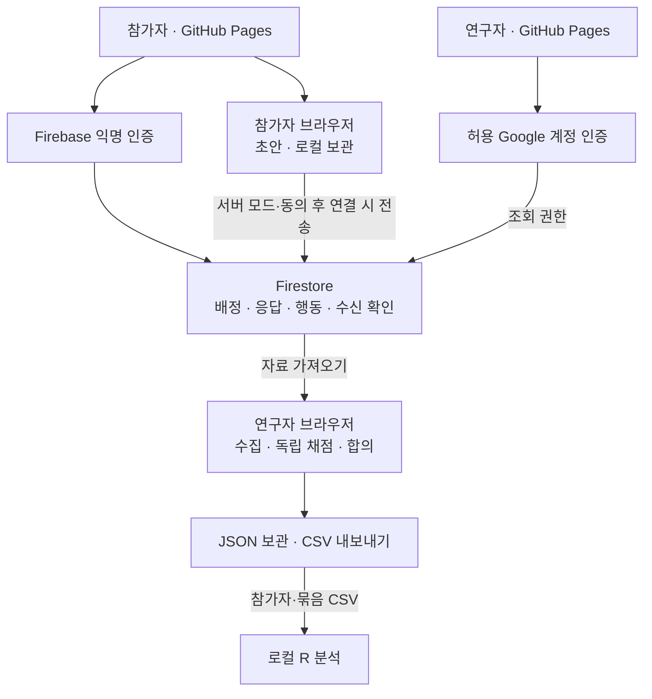
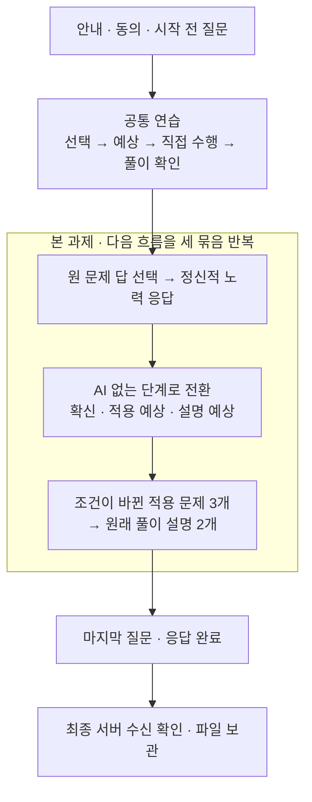

# 판단 워크스페이스 · CRT 연구 v4

AI 추천·설명으로 답을 고른 뒤, **AI 없이 직접 푸는 수행**과 **자신이 예상한 수행**을 비교하는 브라우저 연구 도구입니다. 참가자는 Pages에서 응답하고, 연구자는 수집된 자료를 가져와 두 사람의 독립 채점·합의·분석을 진행합니다.

## 바로 접속하기

| 사용자 | 실제 배포 주소 | 시작 방법 |
|---|---|---|
| 참가자 | [참가자 화면](https://minestero00.github.io/hci/) | 기본 주소는 팀 체험입니다. 사람 파일럿·본 실험에는 연구자가 만든 참여 링크를 사용합니다. |
| 연구자 | [연구자 작업실](https://minestero00.github.io/hci/research.html) | 허용된 Google 계정으로 로그인하고 참여 링크·수집·채점·분석 메뉴를 사용합니다. |
| 개발자 | [로컬 실행](#로컬에서-실행하기) | 기본 자동 수집이 꺼진 로컬 참가자 화면부터 확인합니다. |

| 현재 상태 | 확인된 범위 |
|---|---|
| 배포 완료 | Pages 화면, Firebase 익명/Google 인증 설정, Firestore 규칙·인덱스 |
| 자동 검증 완료 | 실제 서버의 배정·응답·최종 수신, 두 조건의 브라우저 진행, 참가자 교체 |
| 사람 확인 필요 | 연구자의 Google 직접 로그인 후 조회·배정표 생성, 사람 파일럿, 모집·보관 정책 확정 |

배포는 본 실험 개시 승인을 뜻하지 않습니다. 검증일·환경·건너뛴 시험과 남은 항목은 [현재 구현·검증 상태](docs/crt-v4.md#검증-근거)에서 확인하세요.

## 1. 전체 시스템 흐름



| 구성 요소 | 담당하는 일 | 보관 범위 |
|---|---|---|
| GitHub Pages | 참가자·연구자 화면 제공 | 연구 응답을 저장하는 서버가 아닙니다. |
| Firebase Auth + Firestore | 인증, 중앙 배정, 응답·행동 기록과 수신 확인 | 참가자는 자기 실행에 접근하고, 허용 연구자는 수집 자료를 조회합니다. |
| 참가자 브라우저 | 초안 저장, 중단·재개, 파일 보관 | 서버 전송과 별개로 로컬 자료를 보관합니다. |
| 연구자 브라우저 | 가져온 사본, 채점·합의, 초대·배정 보관 | 채점·합의는 자동으로 Firebase에 올라가지 않습니다. 전체 보관 JSON을 내려받으세요. |
| R 분석 | CSV를 읽어 모형·표·그림 생성 | Pages 안에서 실행되지 않습니다. |

서버 최종 수신 확인은 **해당 시점의 응답과 이벤트 묶음이 일치한다는 확인**입니다. 이후 생긴 모든 이벤트의 영구 보관이나 응답의 진실성을 보증하지는 않습니다. [인증·수집·복구 상세](docs/firebase-collection.md)

## 2. 참가자는 어떻게 진행하나요?



AI 지원 조건에는 **본 과제 답 선택과 정신적 노력 응답까지** 고정 추천·설명이 표시됩니다. 무지원 조건에는 표시되지 않으며, 두 조건 모두 예상·직접 수행 단계에서는 원문과 계산기만 사용할 수 있습니다. 실시간 AI 대화는 없습니다.

| 구간 | 참가자가 하는 일 | 구분할 점 |
|---|---|---|
| 공통 연습 | 선택 → 확신·적용 예상 → 적용 3개·설명 1개 → 피드백 | 연습 설명은 형식 연습이며 점수에 넣지 않습니다. |
| 본 과제 세 묶음 | 가격 차이·인쇄 비율·거래 손익을 배정된 순서로 진행 | 적용 문제 순서와 보기 순서는 참가자별로 섞어 고정합니다. |
| 예상 입력 | 확신 0–100, 적용 예상 0–6, 설명 예상 0–4 | 확신과 예상 점수는 다른 질문입니다. 기본값 없이 정수로 입력합니다. |
| 직접 수행 | 답·풀이 또는 ‘모르겠음’을 제출 | 각 문항은 원래 조건에서 독립 출발합니다. 확정 뒤 수정할 수 없습니다. |
| 중단·교체 | 같은 브라우저에서 재개하거나 완료 뒤 새 참여 준비 | 중앙 배정은 계정을 교체합니다. 수동 초대는 다음 참가자의 새 링크가 필요합니다. |

총 **33개 제출 단계**, 약 20–30분을 안내하며 시간 제한은 없습니다. 계산기는 제출 단계마다 초기화됩니다. 상세 문항·점수·순서는 [실험 계획](idea/experiment-plan.md)과 [연구자용 문항표](idea/task-bank-v4.md)를 따릅니다.

## 3. 연구자는 어떻게 수집하고 분석하나요?

| 순서 | 작업 | 다음 단계로 넘길 자료·확인 |
|---|---|---|
| 1 | 연구자 로그인 후 참여 링크 생성 | 사람 파일럿/본 실험을 구분합니다. 기본은 두 집단 × 세 순서의 6조합 중앙 배정입니다. |
| 2 | 서버 자료 또는 응답 JSON 가져오기 | 완료·미완료를 보존합니다. 서버의 완료 자료는 최종 수신을 검증하고, 파일 JSON은 응답 형식을 검증합니다. |
| 3 | 블라인드 채점 묶음 생성 | 조건·예상·확신도·시간을 제외한 답변을 두 채점자에게 전달합니다. |
| 4 | 두 사람이 별도 브라우저에서 독립 채점 | 문항별 0·1·2점 기준으로 채점하고 각 결과 JSON을 모읍니다. |
| 5 | 두 원점수를 확인하고 인간 합의 | 독립 채점을 바꾸면 기존 합의는 무효화됩니다. 현재 점수에 대해 다시 합의합니다. |
| 6 | 작업 현황·제외 사유 확인 후 내보내기 | 전체 보관 JSON으로 백업하고, 참가자 CSV와 묶음·연습 CSV를 R에 전달합니다. |

```sh
Rscript analysis/crt-analysis.R participants.csv cases.csv analysis-output
```

핵심 지표는 **적용 예상 점수 − 인간 합의 적용 실제 점수**입니다. 적용 6점과 설명 4점은 분리하며, 미채점·미제출을 0점으로 바꾸지 않습니다. 작업실의 ‘본 분석 자료 준비’ 수는 최종 연구 적격 승인이 아닙니다. [채점·분석 기준](idea/experiment-plan.md#점수와-데이터)

## 로컬에서 실행하기

Node.js 22 이상이 필요하며, GitHub CI는 Node.js 24를 사용합니다.

```sh
npm ci
npm run check
npm run dev
```

| 화면·검증 | 주소 또는 명령 | 실제 Firebase 사용 |
|---|---|---|
| 참가자 로컬 화면 | http://127.0.0.1:4173/hci/ | 기본값은 사용하지 않음 |
| 연구자 로컬 화면 | http://127.0.0.1:4173/hci/research.html | 서버 버튼을 누르면 실제 Firebase에 연결 시도 |
| 기본 시험·빌드 | `npm run check` | 사용하지 않음 |
| 중앙 배정 에뮬레이터 | `npm run test:allocation` | `demo-hci-crt`만 사용. Firebase CLI·Java 21 필요 |
| 실제 서버 검증 | [라이브 검증 명령과 정리 범위](docs/firebase-collection.md#검증-명령) | 명시적으로 실행할 때 임시 계정·합성 자료 생성 |

로컬 참가자는 `?cloud=1`을 붙이면 실제 서버 자동 수집이 켜집니다. 연구자 화면의 Google 로그인·서버 가져오기·중앙 배정표 생성 버튼은 이 옵션 없이도 실제 Firebase를 대상으로 합니다. R 통합 시험은 Rscript가 있어야 실행되며, 없는 환경에서는 건너뜁니다. 정확한 실행 결과는 [검증 근거](docs/crt-v4.md#검증-근거)에 환경별로 구분되어 있습니다.

## 문서 안내

| 찾는 내용 | 기준 문서 |
|---|---|
| 무엇을 측정하고 어떻게 모집·채점·분석하는가 | [실험 계획](idea/experiment-plan.md) |
| 문항·정답·문항별 부분점수 기준 | [문항표 v4](idea/task-bank-v4.md) — 연구자용 |
| 현재 구현·UI·감사 수정·실행된 검증과 한계 | [현재 구현·검증 상태](docs/crt-v4.md) |
| 인증·배정·수집·장애 복구·배포 명령 | [Firebase 운영](docs/firebase-collection.md) |
| 수정 전 독립 감사의 원래 근거 | [감사 기록](docs/crt-v4-independent-audit.md) — 수정 전 기록 |

<details>
<summary>이전 버전·초기 참고 자료</summary>

업무형 v3는 [참가자 복구 화면](https://minestero00.github.io/hci/legacy-v3.html)과 [연구자 복구 화면](https://minestero00.github.io/hci/legacy-v3-research.html)에서 열 수 있습니다. DB·활성 키·응답 형식은 v4와 분리되며 본 분석에 합치지 않습니다.

- [v3 실험 계획](idea/experiment-plan-v3.md) · [v3 문항표](idea/task-bank-v3.md) · [v3 종합 보고서](docs/final-report.md)
- [v3 화면 내용 검토](docs/screen-content-audit.md) · [v3 브라우저 확인](docs/browser-verification-2026-11-11.md) · [업무 과제 초안 평가](idea/task-review.md)
- [v3 이전의 초기 HTML 예시](idea/ai_understanding_pilot.html)

이 자료와 원본 PDF는 설계 이력이며 현재 운영 지침이나 최신 배포 증거로 사용하지 않습니다.

</details>

응답·합성 기록·내보낸 CSV·인증 정보는 Git에 커밋하지 마세요. `exports/`, `dist/`, `.env*`는 제외됩니다. 정답·루브릭은 공개 저장소에 있으므로 기술적 비밀성을 보장하지 않습니다. 실제 모집 전 사람이 확정해야 할 사항은 [남은 확인 항목](docs/crt-v4.md#사람이-확인할-항목)에 모았습니다.
