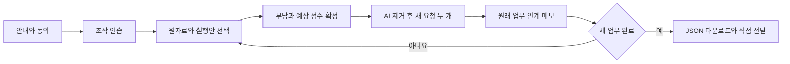

# 판단 워크스페이스 설계와 구현 종합 보고서

작성 기준: 2026년 11월 4일. 콘텐츠·응답 형식은 3.0.0, 참가자 UI는 `2026.11.04-ux3`, 자동 행동 로그는 telemetry 2다. 참가자 화면에서는 AI 지원의 정답성을 미리 보장하는 것으로 읽힐 수 있는 ‘연구팀 검토’ 안내와 시작 안내의 ‘검토된’ 수식을 제거했다. 아래 고정 검증 기록은 이 문구 조정 전 ux2 구현을 대상으로 하며, 후속 문구 조정의 검증·배포는 해당 커밋의 워크플로 기록으로 확인한다.

이 프로젝트는 **정확한 AI 추천·설명이 주어진 뒤, 원자료만으로 새 요청에 대응하는 수행과 자기평가가 어떻게 달라지는지** 조사할 PC 브라우저 파일럿이다. 초기 아이디어 검토, 과제·배점 재설계, 참가자·연구자 화면, 행동 기록, 채점·분석 자료 연결과 GitHub Pages 배포를 포함한다.

현재 결론은 **팀이 전체 절차와 데이터 연결을 검토할 수 있는 정적 파일럿을 구현했다**는 것이다. 사람에게서 얻은 효과·난이도·소요 시간의 결론은 아직 없다. 자동 시험이나 여러 AI 검토자의 일치를 실제 참가자의 이해·채점 타당성 증거로 대체하지 않는다.

- [참가자 페이지](https://minestero00.github.io/hci/)
- [연구자 작업실](https://minestero00.github.io/hci/research.html)
- [저장소](https://github.com/minestero00/hci)
- [배포와 검증 실행 기록](https://github.com/minestero00/hci/actions/workflows/pages.yml)

## 1. 범위와 최종 결정

| 쟁점 | 최종 결정 | 이유와 해석 범위 |
|---|---|---|
| 환경 | PC 브라우저, 창 너비 900px 이상 | 원자료와 응답을 나란히 비교한다. 좁아진 창에서도 복구 다운로드는 제공한다. |
| 인원 | 약 20명 예상, 상한으로 고정하지 않음 | 자원에 따른 예상치다. 통계적 검정력을 보장하는 수가 아니다. |
| 참여 방식 | 짧은 조작 연습 후 비동기 참여 가능 | 대면·원격 운영은 사람 파일럿에서 결정하고 기록한다. |
| 조건 | 동일 원자료만 / 원자료에 AI 추천·설명 추가 | 한 참가자는 한 조건으로 세 업무를 수행한다. |
| AI 정답성 | 미리 작성하고 정확성을 검토한 고정 문안 | 이번 연구에서 지원의 유무와 지원의 오류를 한꺼번에 조작하지 않는다. |
| 환각 | 현재 실험 요인에서 제외 | 이 결과로 잘못된 AI 조언의 탐지·신뢰 조절을 주장하지 않는다. |
| 독립 평가 | 원자료 유지, AI 지원 제거 | 자료를 다시 참고하며 조건을 적용하는 수행을 본다. 암기 시험으로 해석하지 않는다. |
| 배점 | 사례당 선택형 2점 + 서술형 2점 | 최초 실행안 선택은 보조 결과다. |
| 서술형 | 필수 응답, 명시적 모르겠음 허용 | 관계를 설명하는 근거를 확보하되 억지로 글을 만들게 하지 않는다. |
| 인간·AI 채점 | 인간 합의 주 분석, AI와 평균 보조 분석 | 인간과 AI의 불일치가 평균 속에 사라지지 않게 각각 보존한다. |
| 저장 | IndexedDB와 수동 JSON 전달 | 현재 요청에 따라 Supabase·자동 수집 서버를 연결하지 않았다. |
| 배포 | GitHub Pages, main 변경 시 검증 후 배포 | 팀에 전달할 고정 주소와 재현 가능한 빌드 절차를 제공한다. |

AI 지원은 추천과 설명을 함께 포함한다. 따라서 추천만의 효과, 설명만의 효과, AI라는 출처 표시만의 효과를 분리하지 못한다. 정확한 지원도 사용자의 처리 방식에 따라 수행·예상 점수와 다른 관계를 보일 수 있다는 질문을 다루며, 실제 효과의 방향은 미리 결론 내리지 않는다.

## 2. 초기 아이디어 평가와 과제 개선

초기 아이디어의 장점은 지원을 받았을 때의 느낌과 이후 실제 수행을 같은 척도에서 비교할 수 있다는 점이다. 다만 쉬운 문항의 정답률만으로는 자료를 이해한 사람과 추천 이름만 반복한 사람을 구별하기 어려웠다. 문제를 길게 만들거나 소재만 바꾸는 것으로 이 측정 문제를 해결하지 않도록 재설계했다.

| 과제 | 판단해야 할 관계 | 보완한 평가 방식 |
|---|---|---|
| 행사 운영 | 명단 확정·예약 마감, 활동 인력·입구 전담, 준비 시간 | 새로 가능한 장소와 최종 선택을 함께 고르고, 추가 인력의 실제 배치를 판단한다. |
| 문서 공유 | 상속 권한·개별 초대, 원문·고정본, 댓글·편집 | 실제 유효 권한과 필요한 조치를 연결하고 원문·제출본의 후속 처리를 구별한다. |
| 제출 일정 | 병렬 작업·선행 의존, 완성 PDF, 전송·링크 확인 | 기존 카드의 문구 준수 대신 새 작업 순서와 완료 결과를 평가한다. 합리적인 순서 조정을 인정한다. |

세 과제는 연구용 가상 업무다. 실제 학교 정책이나 특정 제품의 권한 규칙을 재현한다고 주장하지 않는다. 참가자는 해당 화면의 가상 규칙만으로 응답할 수 있다.

서술형은 원래 업무의 판단 근거를 묻는다. 두 후속 요청 이후 작성하므로 이후 질문의 영향을 완전히 제거한 순수 회상 측정은 아니다. 총점은 새 조건 적용과 설명 수행을 합한 값이며 각각의 하위 점수도 보존한다.

원자료·실제 선택지·AI 문안·정답·배점 기준·동등 표현은 [과제 원문과 채점 기준](../idea/task-bank-v3.md)에 전부 수록되어 있다. 실행 콘텐츠는 [content.mjs](../web/content.mjs), 정답과 루브릭은 [research-key.mjs](../web/research-key.mjs)를 기준으로 한다. [이전 독립 평가](../idea/task-review.md)는 수정 전 초안의 진단 기록이며 현재 문항을 그대로 평가한 결과가 아니다.

## 3. 참가자 절차와 조건 통제

연습 1회와 업무별 5회로 총 16개 제출 단계다. 사례 안에서 실행안 선택 → 부담·예상 점수 → 새 요청 1 → 새 요청 2 → 인계 메모 순서를 따른다. 각 후속 요청은 매번 원래 상황에서 출발하며 다른 요청의 변경을 누적하지 않는다.

AI 지원은 지원 조건의 최초 판단과 예상 점수 단계에서만 표시한다. 이후 두 조건 모두 원자료와 원래 후보 절차를 참고한다. 원자료의 구성·폭과 응답 구조는 두 조건에서 같고, 최초 두 단계의 지원 영역 높이도 동일하다. 원자료 조건에는 중립 안내를 둔다. 평가 단계의 안내 영역은 두 조건 모두 짧아진다.

초대 링크는 조건·세 업무 순서·후속 요청 순서를 고정한다. 4명 블록마다 두 조건을 2명씩 나누고 조건별로 세 업무의 여섯 순서를 섞는다. 마지막 불완전 블록이나 여러 연구자가 따로 만든 배치까지 전역 균형을 보장하지 않는다. 수집 담당자 한 명이 초대 목록을 관리한다.

기본 주소로 시작하면 팀 체험으로 기록한다. 연구자 작업실에서 만든 배정 링크로 시작해야 초대 파일럿으로 기록한다. 팀 체험은 기본 분석 CSV에서 제외하며 포함 옵션으로 확인한다. 콘텐츠·UI를 변경한 팀 체험이나 사전 파일럿을 본 실험에 섞지 않는다.

## 4. UI와 UX 설계 결론

`ui-ux-pro-max`의 디자인 시스템과 단계 진행·오류 피드백 지침을 조회했다. 검색 결과의 포트폴리오·홍보용 화면 구성은 이 과제에 맞지 않아 사용하지 않고, 관련 있는 평면적 구성·시각 계층·대비·명시적 상태 피드백을 적용했다. 한국어 시스템 글꼴과 로컬 SVG를 사용하며 외부 폰트·UI CDN을 추가하지 않았다.

### 참가자 화면

| 개선 | 구현 | 기대하는 사용성 변화와 확인할 점 |
|---|---|---|
| 시작 전 이해 | 실제 업무 목록, 짧은 절차, 시작 패널, 수집 요약·상세 안내 | 무엇을 하고 무엇을 전달할지 시작 전에 확인한다. 안내를 실제로 이해하는지는 사람 파일럿에서 확인한다. |
| 현재 위치 | 업무 목록과 5단계 진행 표시, 전체 진행률 | 이전 응답으로 돌아갈 수 있는 메뉴로 오인하지 않도록 단계는 비상호작용 진행 표시다. |
| 원자료 접근 | 자료 바로가기, 읽던 스크롤 위치 유지 | 매 단계 자료 상단부터 다시 찾는 부담을 줄이려는 설계다. |
| 병렬 검토 | 원자료와 현재 응답의 독립 스크롤 영역 | 긴 자료를 보면서 응답에 접근한다. 낮은 화면 높이와 스크롤 발견성은 실물 PC에서 확인해야 한다. |
| 자기평가 | 방금 확정한 실행안 표시 | 선택을 기억해 내는 부수적인 부담을 줄인다. 정오 정보는 표시하지 않는다. |
| 오류와 확정 | 입력 근처 오류, 입력 포커스, 저장 중 상태, 중복 제출 방지 | 빠진 응답을 찾기 쉽게 하고 저장 중 이중 행동을 막는다. |
| 도움과 중단 | 도움말·기록 안내·일시 중단 대화상자, 초점 복원·가두기 | 현재 위치를 잃지 않고 확인한다. 재접속은 잠금 획득 후 최신 기록을 다시 읽는다. |
| 전달 | 다운로드와 담당자 전달을 분리한 완료 안내 | 다운로드 자체가 서버 제출이라는 오해를 줄인다. |
| 복구 | 저장 실패 시 경고·이동 차단·복구 JSON, 좁은 창에서도 다운로드 | 저장에 성공하지 않은 응답을 저장 완료로 안내하지 않는다. |

기본 본문 16px, 주요 보조 설명 14~15px, 충분한 줄 간격, 테두리·색·체크 표시를 함께 쓰는 선택 상태, 키보드 초점 표시와 reduced-motion 규칙을 적용했다. 모든 작은 보조 문자가 16px인 것은 아니다. PC 기준을 유지하며 휴대폰에서 본 과제를 수행하게 만들지 않았다.

### 연구자 화면

연구자 작업은 **링크 배정 → 파일 수집 → 독립 채점 → 분석 내보내기**로 연결한다. 수집 화면은 익명 코드·실행 ID 검색, 실행 종류·완료 상태 필터, 참가자별 기록 탐색을 제공한다. 필터 입력 중에는 입력 요소를 교체하지 않아 초점이 유지된다.

행동 탐색기는 실행·단계·자료별 요약, 원본 JSON, 요약 JSON, 이벤트·업무 필터와 60개 단위 타임라인을 제공한다. 화면에는 한 페이지를 표시하지만 원본 이벤트는 보존한다. 상세 미리보기에는 긴 JSON의 표시 길이 제한이 있으므로 원본 파일이 완전한 확인 기준이다.

채점 화면에는 역할·진행률, 다음 미채점 이동, 저장 후 다음 답안, 미저장 상태의 이동·가져오기 확인을 제공한다. 저장 실패를 성공으로 안내하지 않고, 보관 파일 재가져오기에서 응답 충돌과 채점 충돌을 구분해 알린다. 채점 이력도 보관·복원한다. 채점 화면에는 행동 지표를 전달하지 않는다.

## 5. 점수와 분석 계획

| 항목 | 범위 | 용도 |
|---|---|---|
| 최초 실행안 | 정오 또는 모르겠음 | 초기 판단의 보조 결과 |
| 새 요청 1 | 0 또는 1점 | 새 조건 적용 |
| 새 요청 2 | 0 또는 1점 | 새 조건 적용 |
| 인계 메모 | 0, 1, 2점 | 필요한 관계의 설명 |
| 예상 점수 E | 0~4점, 0.5점 간격 | 독립 평가를 보기 전의 자기평가 |
| 정신적 노력 | 1~7점 | 최초 실행안 결정에 든 주관적 노력 |

서술형은 두 관계 기준을 정확히 연결하고 상충 오류가 없으면 2점, 유효한 부분 근거가 있으나 불완전하거나 결론에 오류가 있으면 1점, 유효한 근거가 없거나 모르겠음이면 0점이다. 글 길이·문체·AI 문구와의 일치로 가점하지 않는다. 미제출·미채점은 0점으로 바꾸지 않는다.

선택형 합계 M, 인간 합의 메모 H, AI 메모 L에 대해 다음 세 점수를 별도로 보존한다.

- 주 분석 실제 점수 S = M + H
- AI 보조 실제 점수 = M + L
- 인간·AI 평균 보조 = M + (H + L) / 2

인간 채점자 두 명은 같은 블라인드 묶음을 각자 별도 브라우저에서 채점한다. 조건·예상 점수·최초 선택·행동 로그·다른 사람과 AI 점수를 숨긴다. 두 독립 점수를 가져온 뒤 합의한다. 역할 선택은 인증 장치가 아니므로 실제 운영에서도 독립성을 지켜야 한다.

AI 채점은 익명 입력 묶음과 결과 파일 연결을 지원한다. 웹에서 모델을 자동 실행하지 않는다. 실제 모델 식별자·프롬프트 버전·점수·근거를 포함한 결과를 가져온다. 인간과 AI 점수의 단순 평균이 더 정확하다고 검증한 것은 아니며, 불일치·인간 간 차이·원점수도 함께 보고한다.

주 결과는 사례별 E−S를 먼저 구한 뒤 참가자별로 평균한 값이다. 평균 절대오차는 mean(|E−S|)이며 abs(mean(E−S))로 대체하지 않는다. 참가자 평균의 집단 차이를 분석하고, 사례·로그 수를 독립 참가자 수로 부풀리지 않는다. 집단 평균·분포·불확실성, 실제 점수와 예상 점수, 적용·설명 점수, 중단·결측을 함께 보고한다. 구체적인 통계 계획은 [실험 실행 계획](../idea/experiment-plan.md)의 채점과 분석 절을 따른다.

E−S가 증가했다고 자기평가가 반드시 나빠진 것은 아니다. −1에서 0으로 바뀌면 더 정확해진 것이다. 실제 점수 4점에서는 예상 척도 상한으로 과대평가를 관찰하기 어렵다. 비유의 결과를 동등성이나 효과 없음의 입증으로 쓰지 않는다.

## 6. 행동 로그 명세

### 수집 원칙

‘모든 행동’의 구현 범위는 **동의 후 이 페이지 안에서 브라우저가 관찰한 상호작용과 상태**다. 일부 고빈도 행동은 표본·집계이며 한 번의 물리적 행동과 이벤트 한 행이 항상 일치하지 않는다. 답안 본문과 수정본은 응답 데이터로 보관하지만 자동 상호작용 로그에서 문자 키·클립보드 내용·선택 원문을 별도로 수집하지 않는다.

| 행동군 | 주요 이벤트 | 저장하는 관찰 |
|---|---|---|
| 실행·제출 | `recorder_started/stopped`, `session_opened`, `step_submitted`, `step_entered`, `workspace_presented` | 실행 상태, 재개 여부, 단계, UI 버전, 자료 위치 복원 |
| 클릭 | `click`, `double_click`, `context_menu`, `pointer_down` | 안정적인 대상·영역 ID, 버튼·수정키, 일부 좌표 |
| 포인터 | `pointer_move`, `hover_end` | 200ms 간격 이동 표본, 좌표·상대 위치·표본 간 거리, 머문 구간 |
| 스크롤 | `scroll`, `scroll_end` | 250ms 간격 표본, 위치·깊이·방향, 구간 거리·방향 전환·초기 위치 확인 여부 |
| 선택 | `control_change` | 선택 그룹, 조작 대상, 체크 상태, 이전 선택에서의 수정 여부 |
| 입력 | `input_started`, `input_action`, `field_session` | 입력 유형·길이·입력 횟수·삽입·삭제·되돌리기·IME·붙여넣기 횟수 |
| 한글 조합 | `composition_start/end` | 조합 시작·종료와 길이. 조합 중 단계 확정을 막고 완료 후 초안을 보관한다. |
| 복사·선택 | `paste/copy/cut`, `selection` | 발생 사실과 선택 길이·위치 식별자. 원문·클립보드 내용은 넣지 않는다. |
| 키보드 | `key_navigation`, `key_action` | 탐색·실행·편집 조작의 허용된 키 종류와 수정키. 일반 문자 전체는 넣지 않는다. |
| 포커스·탭 | `focus_in/out`, `window_focus/blur`, `visibility`, `page_hide/show` | 입력 요소·창 포커스, 숨김 여부, 페이지 생명주기 |
| 자료 | `source_viewport`, `source_exposure_start/end`, `source_jump` | 자료 ID, 교차 비율, 노출 구간, 바로가기 사용 |
| 안내·검증 | `dialog_opened/closed`, `overlay_state`, `validation_error`, `validation_invalid` | 도움·중단 안내, 덮인 화면, 빠진 필드·오류 종류 |
| 환경·품질 | `heartbeat`, `viewport_resize`, `connection`, `runtime_error`, `storage_failure/recovered`, `export_requested`, `export_warning` | 창 크기, 저장 상태, 오류 종류, 복구 경고 |
| 시간 | `engagement_segment` | 관찰된 전경·숨김·창 비활성·최근 조작·무입력 구간 |
| 응답 수정 | `draft_revision` | 답안 값의 수정본. 키보드 문자별 기록과 구분한다. |

포인터 거리는 5Hz 표본 사이의 거리이므로 실제 손의 궤적 길이가 아니다. 스크롤에는 자료 바로가기·위치 복원과 같은 프로그램 이동도 포함될 수 있다. `source_jump`와 `workspace_presented`를 함께 보고, 모든 스크롤을 수동 탐색으로 단정하지 않는다. 입력 집계는 브라우저 입력 이벤트 수이며 실제 키 타수와 다르다.

### 연결 키와 시간

이벤트는 `id`, `runId`, `pageId`, `sequence`, `at`, `monotonicMs`, `phase`, `taskId`, `updateId`, `type`, `data`를 가진다. UUID·페이지 내 순번·UTC 시각으로 연결하고 페이지 내부 경과 구간은 단조 시계로 계산한다. `data.telemetryVersion`과 시작 이벤트의 `uiVersion`을 보존한다.

`performance.now()`는 시스템 시계 조정에 영향을 받지 않는 단조 시계를 제공하지만, 서로 다른 페이지의 같은 경과값을 하나의 시계로 비교할 수는 없다. 페이지·기기·절전 상태의 차이를 고려해 구간별 값을 사용한다. [MDN Performance.now 문서](https://developer.mozilla.org/en-US/docs/Web/API/Performance/now)

### 시간 지표의 정의

- `durationMs`: 기록기가 관찰한 구간 합계. 첫 시작부터 최종 제출까지의 전체 달력 시간과 다르다.
- `foregroundMs`: 문서가 숨겨지지 않고 브라우저 창이 포커스를 가진 구간.
- `activeMs`: 전경 구간 중 최근 30초 안에 페이지 조작이 있었던 구간. 포커스 복귀만으로 다시 조작한 것으로 취급하지 않는다.
- `idleMs`: 전경이지만 위의 최근 조작 기준에 해당하지 않는 구간. 읽고 생각하는 시간일 수도 있다.
- `hiddenMs`: 탭·문서가 숨겨진 구간.
- `blurredMs`: 문서는 표시 상태지만 창 포커스가 없는 구간.

전경 = 최근 조작 + 무입력, 전체 관찰 구간 = 전경 + 숨김 + 창 비활성으로 분리한다. 도움·중단 대화상자는 정당한 전경 UI 사용이므로 시간 구간에는 남기되, 뒤에 가려진 자료의 노출은 중단한다. 중간 다운로드도 checkpoint로 진행 중인 집계를 잘라 포함하고 이후 기록을 계속한다.

자료 노출은 기하학적 교차와 문서·창 상태로 계산한다. 페이지의 숨김 상태와 창 포커스는 다른 신호이며 둘을 함께 쓴다. 이 신호는 눈의 위치·인지적 주의·실제 독해를 측정하지 않는다. [W3C Intersection Observer 초안](https://www.w3.org/TR/intersection-observer/), [MDN Page Visibility 문서](https://developer.mozilla.org/en-US/docs/Web/API/Page_Visibility_API)

여러 자료가 동시에 보이면 노출 시간이 겹친다. 부모·행·문단이 중첩될 수도 있어 자료별 시간 합계를 한 사람의 전체 체류 시간으로 쓰지 않는다. 작은 교차 영역도 관찰될 수 있고 비율을 함께 보존한다. UI가 직접 띄운 대화상자는 처리하지만 운영체제의 가림·시선·다른 앱 내용까지 완전하게 식별하지 못한다.

### 저장과 누락

행동 로그는 2초 또는 일정 배치 크기에서 IndexedDB에 저장한다. 답안 수정본은 500ms 유휴, 연속 입력 중 2초, 조합 완료·포커스 이탈에 저장한다. 실패한 이벤트는 대기열에 유지하고 복구 다운로드에 포함한다. 저장 실패 시 시작 화면으로 이동해 성공처럼 보이지 않도록 막는다.

탭·브라우저 강제 종료, 기기 장애, 저장소 삭제, 브라우저의 이벤트 지연까지 손실 없이 보장하지 않는다. 마지막 배치와 미완료 구간은 유실될 수 있다. 저장 실패·내보내기 경고·로그 형식 차이를 품질 표지로 확인한다. 이전 로그에 없던 시간은 0으로 추정하지 않고 결측으로 둔다. 기존 카운터는 관찰 가능한 이벤트만 세며 없는 이벤트를 행동 부재의 증거로 쓰지 않는다.

현재 가져오기는 실행당 200,000 이벤트, 파일당 30MB 제한을 둔다. 제한을 넘는 장시간 테스트 파일은 임의로 잘라 가져오기보다 원본을 보관하고 처리 방식을 조정해야 한다. 타임라인의 60행 표시 제한은 원본 삭제와 무관하다.

## 7. 파일과 CSV 구조

참가자는 응답·확정 이력·수정본·이벤트가 함께 있는 JSON을 전달한다. 연구자는 여러 파일을 가져오고 전체 보관 JSON을 따로 내려받는다. 동일한 실행·동일 내용은 중복 제거한다. 같은 실행에 다른 내용이 있으면 기존 자료를 유지하고 충돌을 표시한다. 중간 파일과 최종 파일을 자동으로 최신 합성하지 않으므로 **담당자가 최종 파일을 구분해 수집**한다.

중간 파일을 먼저 가져온 경우 현재 작업실에는 해당 실행의 최종본을 덮어쓰는 기능이 없다. 복구할 때는 기존 작업실의 전체 보관 JSON과 변경하지 않을 실행의 원본 JSON을 먼저 내려받는다. 별도의 새 브라우저 프로필에서 빈 연구자 작업실을 열고, 변경하지 않을 원본들과 해당 실행의 최종 JSON만 가져온다. 최종 응답을 대조한 뒤 새 채점 묶음을 생성하고 독립 채점한다. 이전 점수를 검증 없이 재사용하거나 기존 보관 파일 전체를 새 작업실에 다시 넣으면 이전 응답·점수가 섞일 수 있다. 이 수동 재구성의 부담은 현재 파일 기반 도구의 제한이며, 정상 운영에서는 최종 JSON을 한 번 수집하는 방식으로 피한다.

| 내보내기 | 단위와 핵심 내용 |
|---|---|
| 참가자 CSV | 실행, 조건, 완료·중복 초대·준비 표지, 평균 점수·예상·차이·절대오차·노력 |
| 사례 CSV | 업무·순서, 최초 선택, 예상·부담, 선택형·인간·AI·평균 점수와 차이, 개별 채점·메모 |
| 문항 CSV | 후속 요청·메모 응답 ID, 선택·본문·자동 점수·인간·AI 점수 |
| 행동 원본 CSV | 이벤트 연결 키·시각·종류와 `data_json` |
| `hci-behavior-runs.csv` | 실행별 시간·카운터·기록 품질·UI 및 로그 버전 |
| `hci-behavior-stages.csv` | 실행·업무·요청·단계별 시간과 조작 카운터 |
| `hci-behavior-sources.csv` | 실행·자료 ID별 노출·hover·교차 비율 |
| 블라인드 묶음 | 조건·예상·행동을 뺀 답안과 원자료·루브릭 |
| AI 채점 묶음 | 익명 답안·루브릭·출력 형식. 실제 모델 실행은 별도 |
| 전체 보관 JSON | 원응답, 채점·채점 이력, 초대 목록, 채점 묶음·역할 |

행동 CSV 세 종은 `study_version`, `run_id`, `participant_code`, `mode`, `condition`을 공유한다. 실행별 표의 주요 열은 `event_count`, `page_count`, `duration_ms`, `foreground_ms`, `active_ms`, `idle_ms`, `hidden_ms`, `blurred_ms`, `clicks`, `pointer_samples`, `pointer_distance_px`, `scrolls`, `choice_changes`, `input_actions`, `paste_count`, `selection_count`, `focus_switches`, `hover_ms`, `telemetry_versions`, `ui_versions`, `legacy_events`, `storage_failures`, `export_warnings`, `has_segments`, `quality_warnings`다.

단계별 표는 `phase`, `task_id`, `update_id`, 여섯 시간 열과 `clicks`, `choice_changes`, `input_actions`, `paste_count`, `scrolls`를 가진다. 자료별 표는 `source_id`, `exposure_ms`, `exposure_count`, `max_ratio`, `hover_ms`를 가진다. 모든 행동 CSV는 팀 체험 포함 옵션을 따른다. 값이 없는 시간은 빈칸이고 버전·경고 목록은 JSON 문자열이다.

`primary_eligible`은 초대 참여·완료·세 사례 인간 채점·중복 초대 미발견이라는 자료 준비 표지다. 연구 참여 적격성·사전 제외·버전 일치·로그 완전성을 전부 판정한 값이 아니다. 오래된 UI의 파일을 읽을 수 있다는 것과 새 UI의 자료와 함께 분석해도 된다는 것은 다르다. `ui_versions`와 운영 기록으로 코호트를 구분한다.

## 8. 독립 검토와 검증 결과

과제 작성 외의 에이전트가 원자료만으로 문항을 풀어 본 뒤 정답과 비교했다. 행사·권한·시간 의존관계의 계산을 자동 시험에서도 별도로 검산한다. 이는 논리 오류 탐지용이며 인간 난이도·현실감을 입증하지 않는다.

UI·기록기·연구자 흐름은 분담 구현한 뒤 각 영역을 별도 맥락의 검토자가 읽었다. 다음 문제를 수정하고 회귀 검증에 포함했다.

- 저장 실패 뒤 나가면서 대기 로그를 잃는 경로와, 응답 초안 저장 실패를 성공처럼 처리하는 경로.
- 오래 열린 연구자 탭의 저장 덮어쓰기, 참가자 이어하기의 최신 기록 재확인, 잠금을 잃은 탭의 다운로드 쓰기 방지.
- 조작된 채점 식별자와 0점·결측 구분, 두 인간 점수 없는 합의 방지.
- 초기 스크롤 거리 누락, 작은 교차 비율 누락, 단계 변경 노출 구간·입력 필드 식별 충돌.
- 대화상자 뒤 자료 노출 제외, 중간 내보내기의 시간·입력 집계 보존.
- 연구자 채점 중 파일 가져오기의 미저장 응답 보호, 보관 이력 복원·중복 제거, 점수 충돌·저장 실패 안내.

로컬 검증은 `npm run check`로 전체 자동 시험과 정적 빌드·모듈 구문 검사를 수행한다. 현재 자동 시험은 40개이며 콘텐츠, 상태 전이, 실제 IndexedDB 모사 트랜잭션·실패, 기록기, 참가자·연구자 DOM 통합 흐름을 다룬다. 한글 조합, 중간 복구, 사람 채점·AI 파일 연결·CSV 내보내기도 검증 범위에 포함된다.

DOM 검증에는 happy-dom과 fake-indexeddb를 사용한다. 실제 Chrome의 렌더링·스크롤·다운로드·접근성 트리 검증과 같지 않다. 이 작업에서는 컴퓨터 사용 도구의 브라우저 정책 차단으로 실제 브라우저 시각 검증을 수행하지 못했다. 따라서 화면 품질과 실제 체감 UX는 아래 사람 파일럿의 확인 대상이다.

GitHub Actions는 main push마다 의존성 설치, 전체 시험, 정적 빌드와 Pages 배포를 수행한다. 최초 배포는 `61a1132`에서 완료했다. 이번 개선 구현의 검증 기록은 다음과 같다. 이 기록을 추가하는 후속 문서 커밋에서는 런타임 코드를 변경하지 않는다.

| 검증 항목 | 고정된 대상과 결과 |
|---|---|
| 구현 커밋 | [dc3797733603d406dddf118519ed50793343aa81](https://github.com/minestero00/hci/commit/dc3797733603d406dddf118519ed50793343aa81) |
| GitHub 검증·배포 | [Actions 41662897880](https://github.com/minestero00/hci/actions/runs/41662897880), build·deploy 모두 success |
| 자동 시험 | 전체 40개, 로컬 및 위 CI의 전체 시험 단계 통과 |
| 정적 빌드 | 모듈 구문 검사와 14개 정적 파일 생성 성공 |
| 배포 완료 | 2026년 11월 4일 00:21 KST |
| 공개 HTTP 확인 | 참가자 루트와 14개 HTML·모듈·CSS 파일 정상 응답, 로컬 빌드와 바이트 일치, 모듈 JavaScript MIME 확인 |

이후 변경은 [워크플로 목록](https://github.com/minestero00/hci/actions/workflows/pages.yml)에서 해당 head SHA의 실행을 확인한다. HTTP·산출물 대조는 실제 브라우저 시각 검증이나 사람 파일럿의 대체가 아니다.

## 9. 해석의 한계와 본 실험 진입 조건

### 독립성 점검

설계·정답·AI 지원문 작성에 AI가 참여했으므로 AI끼리 동의한 결과만으로 타당성을 선언할 수 없다. 두 인간이 원자료에서 독립 검산하고, 실제 답안으로 루브릭 경계를 확인해야 한다. AI 채점을 주 결과로 대체하지 않고 인간·AI 불일치를 보존한다.

참가자는 수집 안내와 AI 지원 유무를 알 수 있어 관찰받는 상황의 영향을 배제하지 못한다. 동의 안내는 유지하되 ‘AI가 과신을 만든다’ 같은 기대 방향을 과제 안내에 제시하지 않는다. 채점자는 조건·예상·행동을 보지 않는다. 연구자의 실험 중 개입·힌트·풀이 확인은 운영 기록에 남긴다.

점수 기준을 설계자가 만든 만큼 그 점수는 정의한 과제의 관계 적용·설명 수행을 측정한다. 이를 일반 지능·실무 능력·장기 학습 저하로 확대하지 않는다. 외부 근거가 없는 참신함이나 효과 크기를 주장하지 않는다.

### 다음 사람 파일럿

우선 4명으로 시작한다. 각 조건 1명씩은 안내·탐색의 이해를 확인하고, 다음 각 조건 1명씩은 말없이 전체 절차를 수행한다. 필요하면 2명 이상 추가한다. 생각을 소리 내는 절차는 진단 파일럿에만 적용하고 본 실험 수행 중에는 사용하지 않는다.

1. 지원할 PC 브라우저와 900·1024·1440px 부근 창 크기, 낮은 화면 높이에서 자료·응답 스크롤 발견성을 확인한다.
2. 한글 입력, 키보드 이동, 오류 초점, 대화상자, 창 축소 중 복구, 잠시 나가기·새로고침·이어하기를 확인한다.
3. 두 후속 요청의 독립 적용과 원래 상황 메모를 구분하는지, 4점 예상 척도를 이해하는지 확인한다.
4. 시간·난이도·만점/영점 몰림, 자료 탐색과 관계 판단의 부담을 기록한다. 화면의 시간 제한은 없으며 기존 20~25분은 실측 전 목표다.
5. 다운로드한 실제 파일을 다른 PC의 연구자 도구에서 가져와 응답·수정·로그·채점·CSV를 대조한다.
6. 인간 두 명이 독립 채점한 뒤 불일치 원인을 검토하고 루브릭을 확정한다.
7. 본 실험 전에 모집 경로·적격 기준·모집 마감·담당자·보관 종료일·배포 버전·분석 계획을 고정한다.

로그가 많다는 이유로 더 좋은 측정이라고 판단하지 않는다. 본 분석에는 예상−실제 차이와 사전 정의한 소수의 행동 지표를 사용하고 나머지는 탐색으로 구분한다. 빠른 응답·탭 이탈·적은 포인터 움직임만으로 부정 참여나 외부 AI 사용을 판정하지 않는다. 효과나 p값을 보고 모집을 끝내거나 연장하지 않는다.

## 10. 팀 운영과 저장소 안내

팀원은 참가자 페이지에서 익명 코드로 체험하고 최종 JSON을 담당자에게 전달한다. 담당자는 연구자 작업실에서 파일을 모으고 원본과 전체 보관 JSON을 별도 보관한다. 개인 응답·실제 수집 자료·연락처는 공개 Git 저장소에 올리지 않는다.

정적 사이트와 연구자 자산은 공개되어 있다. 참가자 앱은 정답 모듈을 불러오지 않지만 정답의 기술적 비밀성, 연구자 인증, 중앙 배정, 변조 방지를 제공하지 않는다. 직접 전달한 파일과 운영 절차를 전제로 하는 팀 파일럿이다. 중앙 수집이 필요한 시점에 서버 저장·인증·버전 고정·수신 확인을 별도 설계한다.

| 경로 | 내용 |
|---|---|
| [README](../README.md) | 실행·체험·파일 전달·배포 안내 |
| [실험 실행 계획](../idea/experiment-plan.md) | 조건·운영·분석 계약 |
| [과제와 채점 기준](../idea/task-bank-v3.md) | 모든 원자료·문항·AI 문안·정답·루브릭 |
| [이전 과제 평가](../idea/task-review.md) | 초안의 문제와 개선 근거 |
| [초기 PDF](<../idea/AI 판단 지원이 독립 수행과 자기평가에 미치는 영향.pdf>) · [초기 HTML](../idea/ai_understanding_pilot.html) | 최초 아이디어와 예시 보존 |
| [app.mjs](../web/app.mjs) · [styles.css](../web/styles.css) | 참가자 UX와 상태·복구 연결 |
| [recorder.mjs](../web/recorder.mjs) · [telemetry.mjs](../web/telemetry.mjs) | 이벤트 수집·구간·기술 통계 |
| [research.mjs](../web/research.mjs) · [research-tools.mjs](../web/research-tools.mjs) | 수집·채점·행동 탐색·분석 자료 |
| [core.mjs](../web/core.mjs) · [storage.mjs](../web/storage.mjs) · [research-store.mjs](../web/research-store.mjs) | 응답 검증·보존·동시 저장 보호 |
| [tests](../tests) | 자동 검증과 회귀 재현 |
| [Pages workflow](../.github/workflows/pages.yml) | 검증 후 배포 |

실행 명령은 `npm ci`, `npm run check`, `npm run dev`이며 로컬 주소는 `http://127.0.0.1:4173/hci/`다. 런타임에는 외부 의존성이나 API 키가 없고 DOM·IndexedDB 시험에 개발 의존성을 쓴다. `dist/`에는 `web/` 정적 파일만 배포한다. 보고서·원문 문서·테스트는 GitHub 저장소에서 열람하며 Pages 참가자 화면에는 섞지 않는다.
